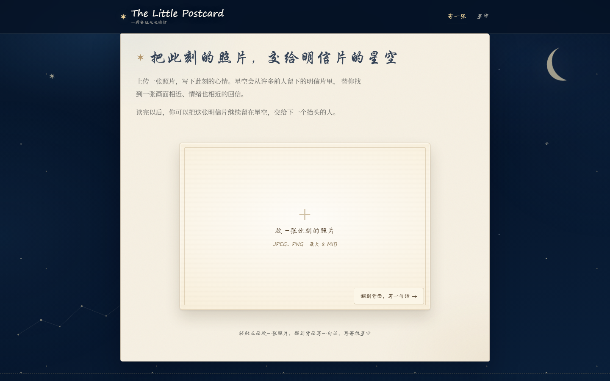
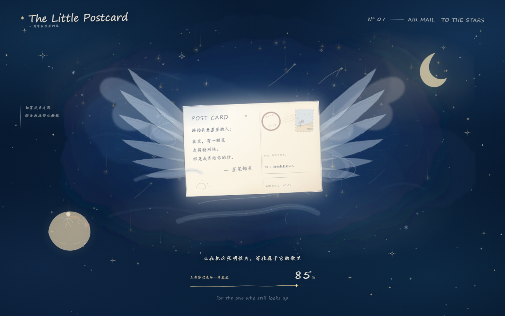
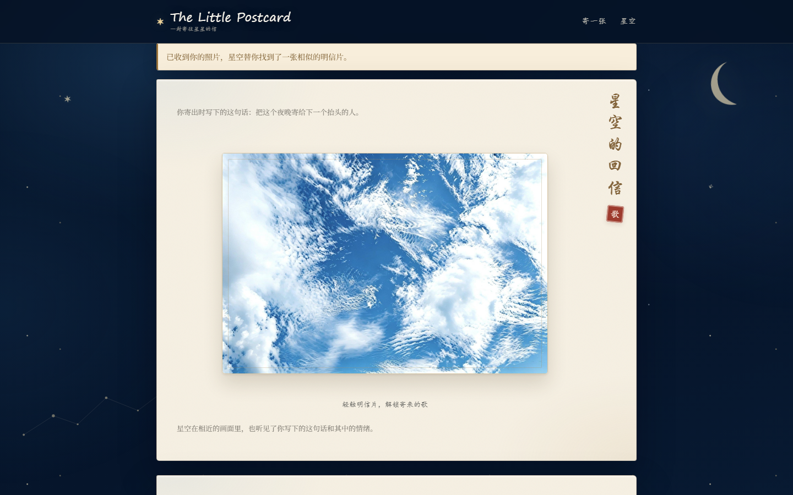
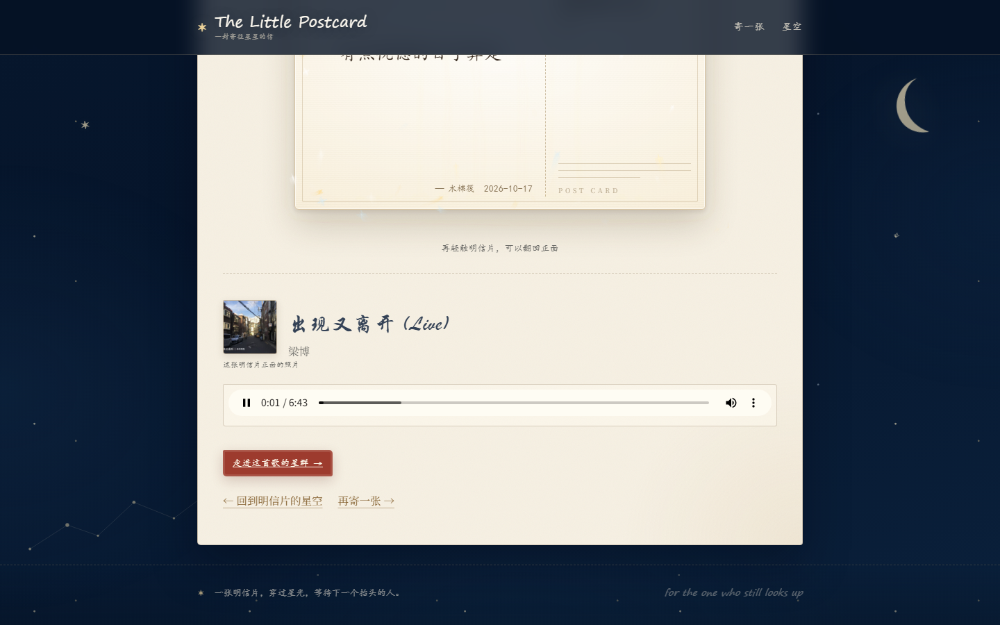
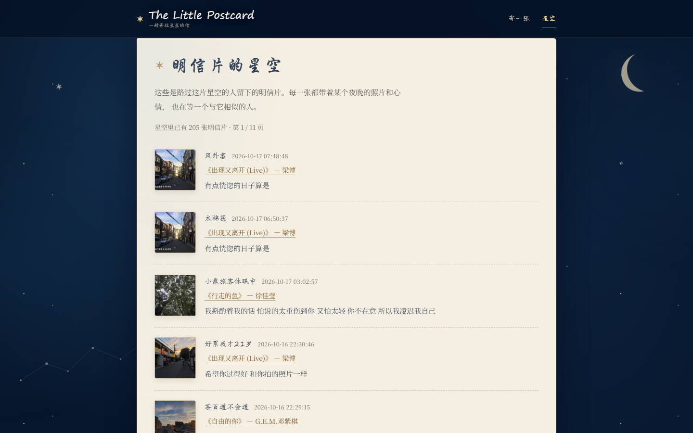
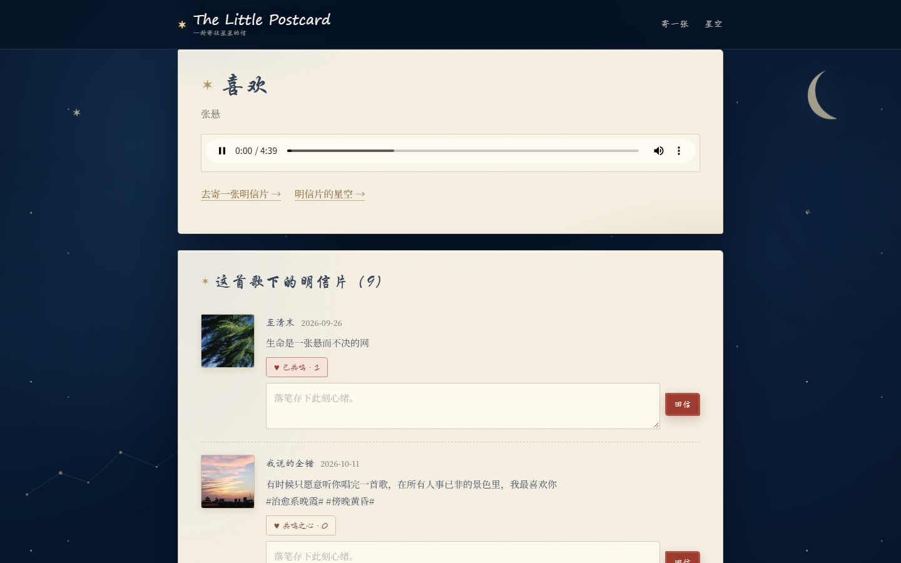
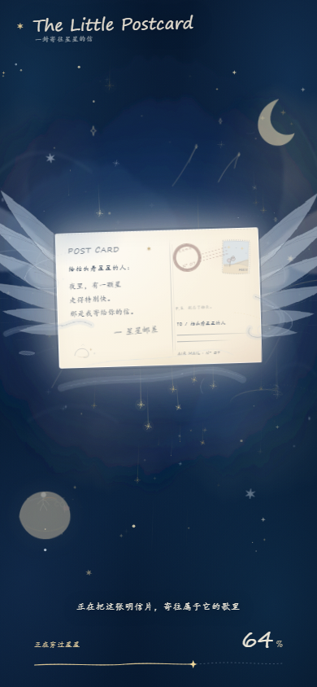
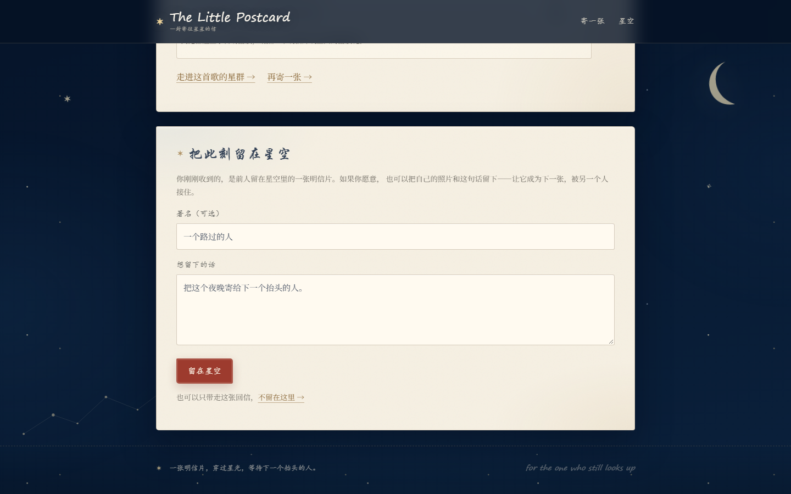

# 🎑 The Little Postcard · 明信片的星空

> **把此刻寄给星空，等待一个与你相似的人。**
>
> 上传一张照片、写下一句话 —— 系统从许多前人留下的「图片 + 心情」明信片里，
> 替你找到与此刻最相近的那张，翻到背面就能听见它的歌，再把你的这张留在星空里。

<p align="center">
  
</p>

---

## 🎯 项目背景 & 用户痛点

你看见一片很好看的晚霞，举起手机拍下来。想写点什么，最后只留下两个字：**好看**。
耳机里的那首歌忽然让你想起某个时刻，却不知道能说给谁听。

于是照片留在相册，歌留在播放列表，心情留在自己这里。

| 现状 | 问题 |
|---|---|
| 相册里几万张照片 | 只能按时间、地点找，**找不回当时的心情** |
| 音乐 App 的每日推荐 | 知道你爱听什么，**不知道你此刻是谁** |
| 朋友圈 / 小红书 | 发出去是给人看的，**不是给自己留一封回信** |

我们缺的不是照片，也不是音乐，**缺的是一个能把此刻接住、再轻轻传下去的地方。**

The Little Postcard 就是这个地方：用「图片相似 + 文字情绪」把陌生人留在同一首歌下的
片段连起来。**不是找到一首歌，是找到那个与你相似的人。**

---

## ✨ 核心功能

首页只有一条流程，五幕完成一个完整闭环：

```text
① 寄一张        ② 穿过星光       ③ 星空的回信      ④ 翻到背面      ⑤ 留在星空
上传照片         深蓝加载动画      收到一张前人         读信 + 听歌      发布明信片
写一句话   →    不是等待而是      「图片 + 心情」   →  歌单里的星群  →  进入留言墙
                故事的一部分      明信片               可以共鸣回复     给下一个人
```

<p align="center">
  
  
  
</p>

**已经实现的功能：**

- 📮 **明信片式上传**：正面放照片、背面写留言，卡片可 3D 翻面；支持 JPEG / PNG，单张 ≤ 8 MiB
- 🔍 **图文混合检索**：CLIP 图片向量为主，中文文本语义 + 情绪色彩做轻微微调，返回**一条**最相近的明信片
- 🎵 **歌曲空间**：进入这首歌的「星群」，本地音频播放器，切换页面不断播
- 💫 **共鸣之心**：点一次 +1、再点一次取消，计数实时更新
- ✍️ **留言墙**：发布 → 上墙，匿名默认「风外客」，可搜索、可翻页
- 🔒 **安全**：CSRF 全表单防护、图片真实格式校验、路径穿越防护、口令门禁（可选）
- 📴 **完全离线**：模型本地缓存，演示阶段不请求任何在线服务

<details>
<summary>📸 更多截图（点击展开）</summary>

| | |
|---|---|
|  留言墙 · 明信片的星空 |  共鸣之心 |
|  移动端 · 穿过星光 |  把这张明信片寄出去 |

</details>

---

## 🛠️ 技术栈

<table>
<tr><td><b>后端</b></td><td>


</td></tr>
<tr><td><b>模型（CPU 离线）</b></td><td>


</td></tr>
<tr><td><b>前端</b></td><td>
原生 HTML / CSS / JavaScript，无框架、无 CDN 依赖 —— 所有字体、样式、脚本全部本地
</td></tr>
</table>

**检索是怎么做的（关键设计）**

```text
候选 = 321 条「图片 + 配文」组合

  图片向量 (CLIP, 512 维)  ──权重 1.0──┐
  文本向量 (BGE-zh, 512 维) ──权重 0.5──┼─→ RRF 名次融合 (k=60) ─→ 取第 1 名
  情绪分值 (StructBERT 校准) ──权重 0.2─┘       ↑
                                    只在这条相对窗口内重排：
                                    与最佳图片相似度相差 ≤ 0.08 的候选
```

- **图片优先保护**：0.08 是**相对窗口**，不是最低匹配阈值，也不是置信度 —— 视觉差距大的图不会被一句留言拉上来。
- **分数不展示、不落库**：页面不出现任何百分比或评分，用户只看到一封回信。
- **短文本不参与**：留言少于 6 字时，文本与情绪项自动退出，完全按图片匹配（避免「好看」两个字主导结果）。

---

## 🚀 本地部署 / 运行指南

### 0. 环境要求

| 项目 | 要求 |
|---|---|
| Python | **3.12**（3.11 亦可；本项目在 3.12.14 实测通过） |
| 操作系统 | Windows / macOS / Linux |
| 内存 | ≥ 4 GB（CPU 推理，三个模型常驻约 1.2 GB） |
| 磁盘 | ≥ 3 GB（依赖 + 模型缓存 + 素材） |

### 1. 克隆并安装

```bash
git clone https://github.com/<your-account>/the-little-postcard.git
cd the-little-postcard

python -m venv .venv
# Windows PowerShell:
.\.venv\Scripts\Activate.ps1
# macOS / Linux:
source .venv/bin/activate

# PyTorch 请先装 CPU 版（体积更小，演示够用）
pip install torch==2.4.1 --index-url https://download.pytorch.org/whl/cpu
pip install -r requirements.txt
```

> Windows 用户也可以直接双击 `setup_env.ps1` 里的流程，一条命令完成以上步骤。

### 2. 准备素材（模型 / 音频 / 图片）

⚠️ **模型缓存、音频、素材图片体积较大，不进 Git 仓库**，需要本地放好 —— 见
**[docs/materials.md](docs/materials.md)**，三步完成：

```bash
# ① CLIP 模型（首次需要联网，之后完全离线）
python -c "from pathlib import Path; from transformers import CLIPModel, CLIPProcessor; p=Path('data/model_cache').resolve(); CLIPProcessor.from_pretrained('openai/clip-vit-base-patch32', cache_dir=str(p)); CLIPModel.from_pretrained('openai/clip-vit-base-patch32', cache_dir=str(p)); print('CLIP cache ready')"

# ② 中文模型（BGE + 情绪）
python scripts/fetch_models.py

# ③ 把音频放到 static/audio/，素材图放到 data/source_images/，按清单填好 CSV
python preprocess.py --seed data/songs_seed.csv --image-manifest data/comment_images_manifest.csv
```

### 3. 启动

```bash
python app.py
```

打开 <http://127.0.0.1:5000> 即可。启动日志出现下面这行表示就绪：

```text
启动完成：数据库=可用 模型=已加载 文本=可用 情感=可用 图片笔记组合=321 兜底歌曲=存在
```

**可选：口令门禁**
把 `.env.example` 复制成 `.env`，填入 `ACCESS_PASSWORD`（访客口令）与
`DEV_DELETE_PASSWORD`（删除入口口令）即可。**不填也能跑**，本地演示不需要口令。

**可选：只验证界面（不需要模型）**

```powershell
# Windows PowerShell
$env:MODEL_DOWNGRADE="1"; python app.py
# macOS / Linux
MODEL_DOWNGRADE=1 python app.py
```

这样不加载 CLIP，上传任意图片都返回兜底歌曲 —— 适合只看 UI、调样式。

### 4. 跑测试

```bash
pytest -q
```

---

## 📁 目录结构

```text
the-little-postcard/
├── app.py                  Flask 应用（路由、会话、CSRF、口令门禁）
├── config.py               集中配置（所有路径基于项目目录，不依赖 cwd）
├── db.py                   SQLite 访问层
├── clip_encoder.py         CLIP 图片特征（512 维，L2 归一化）
├── text_encoder.py         中文文本向量（BGE）+ 情绪（StructBERT）
├── hybrid.py               图片 + 文本 + 情绪 RRF 融合检索
├── matcher.py              纯图片 top-1 匹配
├── image_utils.py          图片校验、规范化、路径安全
├── preprocess.py           离线素材预处理（建库 / 导入 / 向量化）
├── build_index.py          索引回填（幂等）
├── templates/              Jinja2 模板（含深蓝星夜加载层）
├── static/css · static/js   本地样式与脚本
├── scripts/                模型下载、素材去重等工具
├── deploy/                 systemd + Caddy + 隧道配置模板
├── docs/screenshots/       README 用截图
├── data/                   CSV 清单模板（数据库/模型/原图均本地生成）
└── tests/                  pytest 自动化测试
```

---

## 📄 开源协议

本项目基于 **MIT License** 发布，详见 [LICENSE](LICENSE)。

> 演示曲目与图片仅用于非商业技术演示，版权归原作者及平台所有，**不随本仓库分发**（见 [docs/materials.md](docs/materials.md)）。

---

## 👥 团队成员

| | 成员 | 分工 |
|---|---|---|
| 🎨 | **龚涵述** | 产品设计、视觉与交互（明信片 / 星空视觉体系）、前端实现 |
| ⚙️ | **蒋丰屹** | 后端架构、检索算法、模型接入、数据管线与部署 |

---

<p align="center">
  <i>我们希望技术不只是给出答案，也能替人保留一点浪漫。</i><br>
  <b>把此刻寄给星空，等待一个与你相似的人。</b>
</p>
